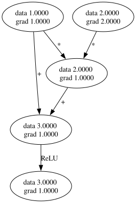

<div align="center">
  
This project was originally my [bachelor thesis](https://kth.diva-portal.org/smash/record.jsf?pid=diva2%3A1985858&dswid=8459), the code used is preserved in the [thesis](https://github.com/21st-centuryman/micrograd-rs/tree/thesis) branch.

</div>
<div align="center">

## Micrograd

[]()
<br>


</div>

## ⇁  Welcome

This is a project to rewrite the [micrograd](https://github.com/karpathy/micrograd) framework by Andrej Karpathy to Rust. This was originally my bachelor thesis to discuss the effects on memory allocation of rewriting micrograd in the Rust programming language. I looked over the limitations of using Rust and how it can be improved to focus on stack allocation.

Since the thesis I have improved this further, making micrograd-rs fully stack allocated using macros and tape-based reverse-mode automatic differentiation. This is further explained in a report on arXiv (coming soon). To keep with the micrograd spirit I have still kept the usage syntax similar to that of micrograd, shown below:

## ⇁  Example usage

```rs
let tape: &Tape = &Tape::<[_; 64]>::new();
let a = tape.value(-4.0);
let b = tape.value(2.0);
let mut c = a + b;
let mut d = a * b + b.pow(3.0);
c = 2.0 * c + 1.0;
c = 1.0 + 2.0 * c + (-a);
d = d + d * 2.0 + (b + a).relu();
d = d + 3.0 * d + (b - a).relu();
let e = c - d;
let f = e.pow(2.0);
let mut g = f / 2.0;
g = g + 10.0 / f;
println!("{:.4}", g.data()); // prints 24.7041
g.backward();
println!("{:.4}", a.grad()); // print 138.8338
println!("{:.4}", b.grad()); // print 645.5773
```

## ⇁  Tracing / Visualization

I have also implemented a draw_dot function that will act similarly to graphviz and digraph, to visualize each node, showing both their data and gradient. The full code is in `examples/graph.rs`, run it with `cargo run --example graph`.

```rust
use micrograd::engine::{Activations::Relu, Tape};
use micrograd::nn::Layer;
let tape: &Tape = &Tape::<[_; 32]>::new();
let n = Layer::<2, 1>::new(tape, Relu);
let x = [tape.value(1.0), tape.value(-2.0)];
let y = n.forward(&x);
y[0].backward();
draw_dot(tape);
```



## ⇁  Training a neural net

You are also able to create more advanced neural nets, such as a 2-layer MLP binary classifier.
The code for the make moons implementation is in the examples folder.

```rust
use micrograd::engine::{Activations::{Linear, Relu}, Tape};
use micrograd::nn::mlp;
mlp!(2, 16, 16, 1);
let tape: &Tape = &MLPTape::new(); // sized by the mlp macro
let model = MLP::new(tape, Relu, Relu, Linear);
let params = tape.len.get();
for (x, y) in xs.iter().zip(&ys) {
    let score = model.forward(&[tape.value(x[0]), tape.value(x[1])])[0];
    let loss = (1.0 - *y * score).relu();
    loss.backward();
    tape.len.set(params);
}
```


## ⇁  Running tests

All tests are in the `tests` folder. You can run them with the following command.

```console
cargo test
```

## ⇁  License

MIT
